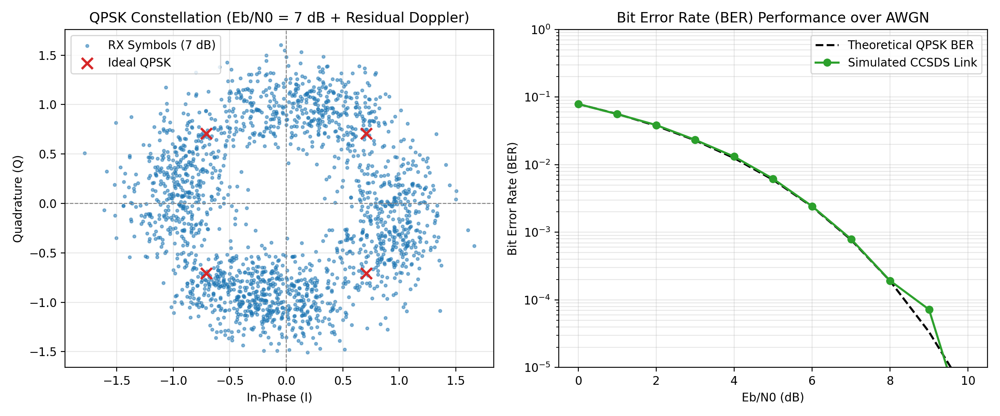

# CCSDS Satellite Telemetry & RF Link Simulator

Simulador de extremo a extremo de un enlace descendente (*downlink*) de telemetría espacial en **Banda S (2.2 GHz)** para satélites en órbita baja (**LEO**), combinando generación y modulación determinista en **C (C11)** con modelado de canal físico y análisis de rendimiento en **Python**.

---

## Arquitectura del Sistema

El proyecto separa las responsabilidades entre el segmento vuelo (*On-Board Computer* / transceptor) y el canal radioeléctrico / estación terrena:

1. **Segmento Vuelo — Núcleo en C (`src/c_core/`):**
   - **Empaquetado CCSDS (`ccsds_frame.c`):** Construcción de tramas binarias empaquetadas sin *padding* (`#pragma pack(1)`) con marcador de sincronismo estándar (`0x1ACFFC1D`), identificador de satélite, contador de trama, *payload* de telemetría y cálculo de **CRC-16-CCITT** (polinomio `0x1021`).
   - **Modulador Banda Base (`modulator.c`):** Mapeo de bits a símbolos complejos $I/Q$ normalizados ($E_s = 1$) en **BPSK** y **QPSK con codificación Gray**, incluyendo demodulador *hard-decision* y verificación *loopback*.

2. **Canal RF y Estación Terrena — Simulador en Python (`src/python_sim/`):**
   - **Link Budget LEO (`channel_sim.py`):** Cálculo de presupuesto de enlace en Banda S (2.2 GHz, distancia oblicua de 1200 km, cálculo de FSPL, PIRE, $C/N_0$ y $E_b/N_0$).
   - **Canal AWGN + Doppler:** Inyección de ruido blanco gaussiano aditivo calibrado por $E_b/N_0$ y deriva de fase por desplazamiento Doppler residual.

---

## Resultados de Simulación



- **Izquierda:** Constelación QPSK recibida a $E_b/N_0 = 7\text{ dB}$ bajo efecto de rotación de fase por Doppler residual no compensado.
- **Derecha:** Curva de tasa de error de bit (**BER**) obtenida sobre las tramas CCSDS frente a la curva teórica $P_b = \frac{1}{2}\operatorname{erfc}\left(\sqrt{E_b/N_0}\right)$.

---

## Ejecución Rápida

### Requisitos
- Compilador `gcc` (estándar C11) y `make`
- Python 3 con `numpy`, `scipy` y `matplotlib`

### Compilar y ejecutar simulación completa
```bash
make sim